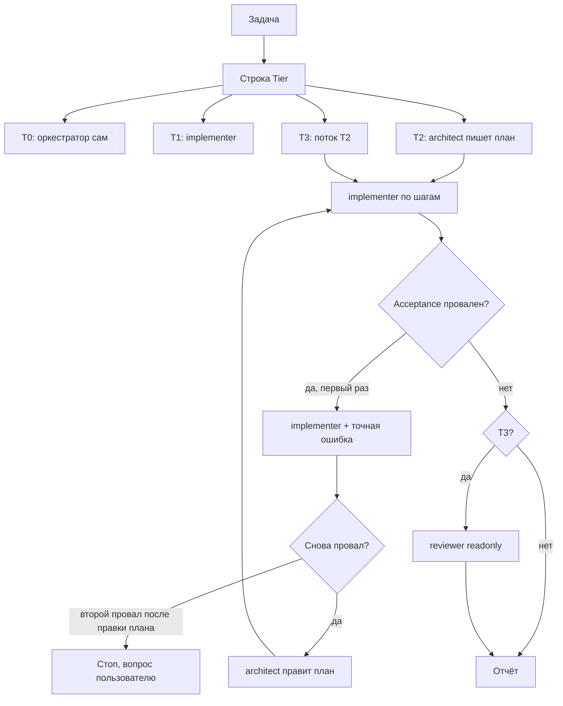

# Маршрутизация моделей и делегирование

**Тип:** Guide  
**Статус:** Canonical  
**Версия:** 1.0  
**Дата:** 2026-10-07  
**Зависит от:** [`ai_first_project_methodology.template.md`](./ai_first_project_methodology.template.md) §2.2–§2.4 (после bootstrap — `ai_first_project_methodology.md`), [`.cursor/rules/model-routing.mdc`](../../.cursor/rules/model-routing.mdc)  
**Связанные документы:** [`AGENTS.md`](../../AGENTS.md) (после bootstrap; до него — [`AGENTS.template.md`](../../AGENTS.template.md)), [`guidelines/README.md`](../../guidelines/README.md), [`guidelines/ai_code_review_protocol.md`](../../guidelines/ai_code_review_protocol.md)

---

## Purpose

Контракт **кто** в сессии Cursor пишет код и **какой моделью**. Длинный контекст чата остаётся дешёвым; дорогое рассуждение и независимая проверка вызываются только там, где ошибка дороже лишних токенов.

Читают оркестратор и человек, который выбирает модель в пикере. Исполнение в каждой сессии — [`.cursor/rules/model-routing.mdc`](../../.cursor/rules/model-routing.mdc) (`alwaysApply`). При расхождении побеждает `.mdc`; этот файл обновляется в том же изменении.

**Runtime продукта:** **Next.js 16.4** (App Router, Vercel). Точный patch — в `apps/web/package.json`, без каретки. Snapshot Pulse (`docs/examples/pulse/`) может оставаться на своём пине; корневые Rules и Guidelines важнее.

## Scope / Out of scope

**In scope:** классификация задачи T0–T3, выбор субагента, файл плана как общая память, эскалация, лимиты контекста и моделей.

**Out of scope:**

- Bugbot и skill `review-bugbot` (платный контур; в репозитории запрещён);
- Security Review (`review-security`) — только по явной просьбе пользователя; это не субагент `reviewer`;
- выбор продуктовых фич и процесс ADR.

**Две оси с одним именем «tier».** T0–T2 в [`.cursor/rules/README.md`](../../.cursor/rules/README.md) — это **когда копировать Cursor Rules** (bootstrap / implementation / Design Lab). T0–T3 в этом файле — **как дешево выполнить задачу**. Не смешивать.

Cursor **Agent Review** (панель IDE, `/agent-review`, Quick/Deep) — отдельный локальный пайплайн. Он не заменяет субагента `reviewer`.

## Definitions

| Термин | Значение |
|--------|----------|
| Оркестратор | Чат. Классифицирует, планирует, делегирует, собирает результат. Отдельного субагента-«роутера» нет. |
| `architect` | Субагент плана. Пишет `.cursor/plans/<task-slug>.md`. Код не пишет. |
| `implementer` | Субагент правок по шагу плана. |
| `reviewer` | Независимая проверка T3. Только чтение. Обязателен до отчёта «готово». |
| Explore | Встроенный поиск по коду. Не `architect`. |
| План | Общая память handoff: путь к файлу + номера шагов, не пересказ чата. |
| Review pipeline | [`agent-code-review-subagent.mdc`](../../.cursor/rules/agent-code-review-subagent.mdc) + [`ai_code_review_protocol.md`](../../guidelines/ai_code_review_protocol.md). Гейт коммита и явного «проверь diff». Не Bugbot. |

Модели закрепляются во frontmatter [`.cursor/agents/*.md`](../../.cursor/agents/), не в тексте промпта оркестратора.

## Requirements

1. **MUST** — первая строка ответа на задачу с кодом: `Tier: T0|T1|T2|T3 —` и причина не длиннее 10 слов.
2. **MUST** — карта моделей (не переопределять в промпте):

   | Роль | Модель | Когда |
   |------|--------|--------|
   | Оркестратор | Composer 2.5, не fast (пикер чата) | Вся сессия. Тяжёлое рассуждение уходит в `architect`. |
   | `implementer` | `composer-2.5[fast=false]` | T0 делает сам оркестратор; T1 и шаги плана — `implementer`. |
   | `architect` | `grok-4.7[effort=high,fast=false]` | T2/T3, пока нет утверждённого плана. |
   | `reviewer` | `grok-4.7[effort=high,fast=false]`, `readonly: true` | T3, до отчёта «готово». |
   | Поиск | Explore | Поиск по репозиторию. |

3. **MUST** — оставаться в пуле Cursor: Grok 4.x и Composer 2.5. Сторонние модели не выбирать.
4. **MUST** — при сомнении между двумя тирами задачи брать **нижний**. Эскалация поправляет ошибку.
5. **MUST** — вопрос без правки кода отвечать самому, без субагента.
6. **MUST NOT** — запускать субагента, если ни одно не верно: шум > ~20k токенов в этом контексте; независимый шаг с файлами и критериями приёмки; независимая проверка (T3).
7. **MUST NOT** — субагент на T0; дробление последовательных шагов в одних и тех же файлах (один вызов `implementer`); задача, которая закрывается ≤ 3 вызовами инструментов.
8. **MUST** — параллелить субагентов только если списки `Files` не пересекаются.
9. **MUST** — каждый шаг плана содержит `Goal`, `Files`, `Acceptance`, `Tier` (по умолчанию T1). Делегату передавать путь плана и номера шагов. Ответ субагента ≤ 15 строк.
10. **MUST** — эскалация: один повтор `implementer` с точной ошибкой → `architect` правит план и не пишет код → `implementer` применяет поправку → стоп и вопрос пользователю. Цикл повторов запрещён.
11. **MUST NOT** — варианты `-fast`, effort `xhigh` и контекст 500k, пока пользователь явно не попросил.
12. **MUST** — один контекст держать ниже ~200k токенов (выше этого Grok 4.7 тарифицируется с множителем 2). Дальше — новый чат или делегирование. Читать файлы по пути, не перечитывать уже известное, править точечно. Когда задача закрыта или контекст устарел — предложить новый чат.

### Классификация задачи

| Тир | Сигнал | Кто делает |
|-----|--------|------------|
| T0 | 1–2 файла, до ~40 строк, намерение однозначно (опечатка, переименование, копирайт, мелкий CSS, одно поле) | Оркестратор. Без субагента. |
| T1 | Есть утверждённый шаг плана **или** правка локальная и определённая | `implementer` |
| T2 | Плана нет; ≥ 4 файлов или кросс-модуль; новая фича; новая зависимость; контракт данных или API; неочевидный баг после одной неудачной попытки | `architect` → план → `implementer` по шагам |
| T3 | Auth, платежи, права, секреты, миграция по живым данным, разрушительные операции, ломающий публичный API | Поток T2 + обязательный `reviewer` до отчёта «готово» |

Для этого продукта к T3 относятся те же границы, что и sensitive zones review pipeline: `proxy.ts`, `packages/policy/**`, `packages/db/**`, миграции, env и `next.config.*`. Доменные инварианты из `AGENTS.md` добавляются по мере заполнения W3/W4.

## Flows

Цикл методологии:

`КОНТЕКСТ → классификация T0–T3 → ФАЗА → КОНТРАКТ → ЗАДАЧИ → реализация по этому контракту → ВЕРИФИКАЦИЯ (typecheck / lint / чеклист фазы) → reviewer, если T3`.

Lint не отменяет `reviewer` на T3. `reviewer` не заменяет `npm run typecheck` и `npm run lint`. Runtime dual-view и lab PSI по-прежнему только по явной просьбе пользователя.

## Review pipeline (не Bugbot)

Ревью кода в репозитории — [`agent-code-review-subagent.mdc`](../../.cursor/rules/agent-code-review-subagent.mdc). Fresh-context там — `generalPurpose` с `readonly: true`. Bugbot не вызывать.

| | `reviewer` (этот контракт) | Review pipeline |
|--|----------------------------|-----------------|
| Когда | T3, до отчёта «готово», даже без коммита | Pre-commit, если пользователь просит commit; standalone, если просит review |
| Кто | `.cursor/agents/reviewer.md`, модель из frontmatter | `generalPurpose`, модель чата |
| Вход | Путь плана + номера шагов | Только постановка задачи, затем diff |
| Глубина | Всегда этот субагент на T3 | `skip` / `diff-only` / `self-full` / `subagent` по зонам и размеру diff |

Оба запрещают Bugbot, оба не правят код, оба ограничивают повтор одной итерацией. Это разные гейты. После `reviewer` на том же diff pre-commit — только `diff-only` (`agent-code-review-subagent` § T3 reviewer gate).

## Acceptance criteria

- [ ] Оркестратор печатает строку `Tier` до делегирования и до правок.
- [ ] T0 закрыт без субагента.
- [ ] T2/T3 начинаются с файла `.cursor/plans/<task-slug>.md`; шаг содержит Goal, Files, Acceptance, Tier.
- [ ] T3 не объявлен готовым без прогона `reviewer`.
- [ ] Проваленный шаг не зациклен: один повтор, затем правка плана, затем стоп.
- [ ] Модель субагента задана файлом `.cursor/agents/*.md`, не фразой в промпте.
- [ ] Контекст чата не раздувается перечитыванием и лишними субагентами.
- [ ] Стек в ответах по runtime — Next.js 16.4, не 16.3.3.

## Drift risks

| Риск | Следствие | Страж |
|------|-----------|--------|
| `.mdc` и этот файл разошлись | Агент следует always-applied тексту, документ врёт | Править оба в одном изменении; приоритет у `.mdc` |
| Нет `.cursor/agents/*.md` в **корне** репозитория | Субагент наследует модель чата; pin из таблицы не работает. Копии внутри `docs/examples/pulse/.cursor/agents/` на этот workspace не действуют | `architect.md`, `implementer.md`, `reviewer.md` в `/.cursor/agents/` |
| `model-routing.mdc` не в tier-manifest и не в `.claude/rules/` | Bootstrap и Claude Code правило не видят | Строка в `.cursor/rules/README.md` §T0, копия в `tiers/t0-always/`, `npm run rules:sync` |
| Цикл `AGENTS` без шага TIER | Реализация идёт моделью чата | Ссылка из методологии и `AGENTS` |
| Review pipeline и `reviewer` на одном diff | Два холодных старта, двойная плата | `agent-code-review-subagent` § T3 reviewer gate: после `reviewer` pre-commit только `diff-only` |
| Имя T0–T2 у Cursor Rules и у задач | Агент путает «скопировать UI-rule» и «не звать субагента» | В тексте писать «task tier» или «rule tier» |
| Документы стека на 16.3.3 в Pulse snapshot | Агент читает устаревший пин из `docs/examples/pulse/` | Корневые Rules/Guidelines override snapshot |

## Related documents

| Документ | Роль |
|----------|------|
| [`.cursor/rules/model-routing.mdc`](../../.cursor/rules/model-routing.mdc) | Runtime-копия, always applied |
| [`ai_first_project_methodology.template.md`](./ai_first_project_methodology.template.md) | Цикл КОНТЕКСТ → TIER → … → ВЕРИФИКАЦИЯ |
| [`agent-code-review-subagent.mdc`](../../.cursor/rules/agent-code-review-subagent.mdc) | Review pipeline, не Bugbot |
| [`ai_code_review_protocol.md`](../../guidelines/ai_code_review_protocol.md) | HOW трёх проходов; читать на `self-full` / `subagent` |
| [Subagents](https://cursor.com/docs/agent/subagents) | Формат `.cursor/agents/*.md` |

## Agent notes

- Роутинг — выбор `architect` / `implementer` / `reviewer` / Explore.
- Субагент начинает с пустого контекста и заново читает файлы. Лишнее дробление дороже, чем один вызов.
- `reviewer` не чинит код. Находки возвращаются оркестратору; правка — снова через `implementer` или, если это уже новый дизайн, через `architect`.
- Вопросы «как устроено» и поиск по коду не повышать до T2.
- Не просить `-fast`, даже если в списке моделей Cursor он есть.
